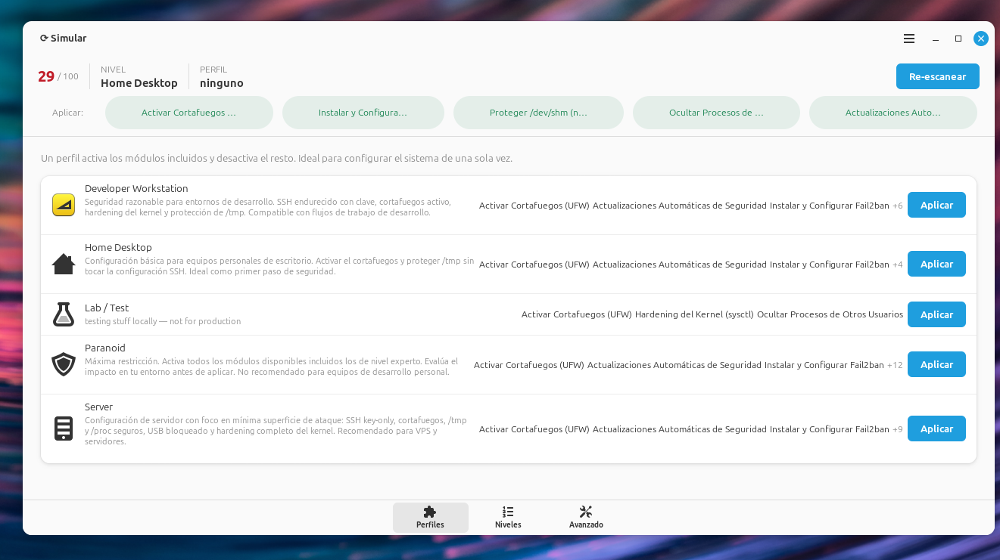
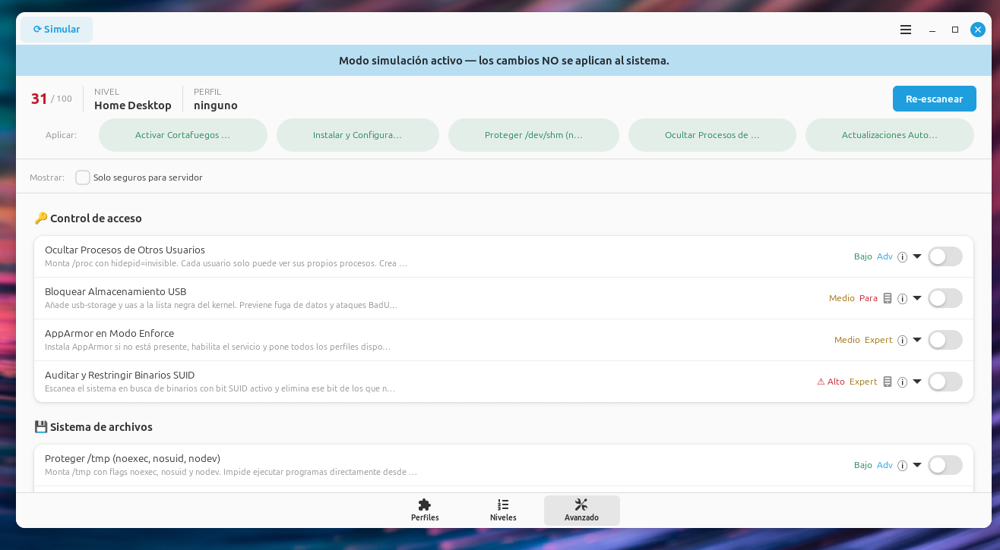
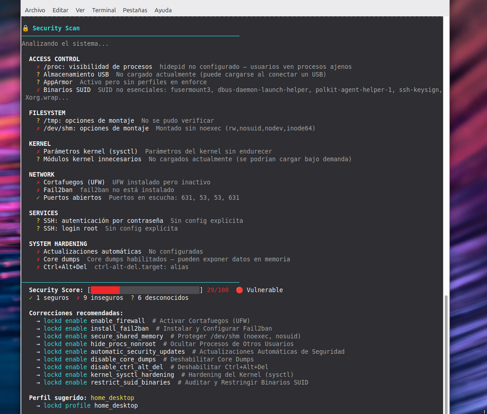

# 🔒 Lockd Linux

[](https://gitlab.com/Ricardo23B/Lockd/-/pipelines)
[](https://www.gnu.org/licenses/gpl-3.0)
[](https://www.python.org/)

🇬🇧 [English version](README.md)

**Herramienta de hardening para Linux con GUI, TUI, CLI y auditoría integrada.**

Lockd convierte configuraciones de seguridad complejas en interruptores simples,
accesibles desde un escritorio gráfico, desde la CLI o en un servidor remoto vía SSH.
Todo cambio se puede simular antes, y la reversibilidad es un objetivo central del diseño.

> **Nota:** el desarrollo y la colaboración ocurren en
> [GitLab](https://gitlab.com/Ricardo23B/Lockd). El repositorio de GitHub
> es un espejo de solo lectura.



---

## Por qué Lockd

- **Hardening comprensible.** Cada módulo explica qué cambia, con su nivel de
  riesgo e impacto, para que decidas con todo el contexto.
- **Simula antes de aplicar.** `--dry-run` muestra el contenido exacto que
  escribiría un módulo, y un test de integración comprueba que, en simulación,
  los 32 scripts enable/disable no modifican los directorios del sistema que
  vigila.
- **Reversibilidad como objetivo de diseño.** Cada módulo incluye scripts
  `enable`, `disable` y `check`, y un test de contrato de punta a punta sigue
  de cerca cuán fielmente desactivar restaura el estado previo.
- **Un motor, tres interfaces.** GUI GTK4 + libadwaita, TUI curses para
  sesiones SSH y una CLI apta para scripts.
- **Cuidado con los privilegios.** Un único helper privilegiado ejecuta los
  módulos desde rutas de root, autorizado por Polkit, y cada operación queda
  en un journal de solo añadir.

Lockd complementa herramientas de auditoría y cumplimiento como Lynis u
OpenSCAP: su foco es aplicar hardening de forma interactiva y controlada, con
simulación y reversión de los cambios.

---

## Capturas

| Modo Avanzado (banner de simulación activo) | Security Scan en la terminal |
|:---:|:---:|
|  |  |

La interfaz y las descripciones de los módulos están por ahora en español; la
versión en inglés está planificada.

---

## Estado

Lockd está en **beta** y sus cimientos ya están construidos:

- **Simulación en la que puedes confiar:** los 32 scripts enable/disable se
  ejecutan con `--dry-run` en un test de integración que verifica que no
  cambia ningún archivo en los directorios del sistema que vigila (como
  `/etc/ssh`, `/etc/systemd/system` y `/var/lib/lockd`).
- **Helper privilegiado y journal:** los módulos corren desde rutas de root vía
  Polkit y cada operación se registra en `/var/lib/lockd/journal.jsonl`.
- **Estado fiel al sistema real:** el estado de los módulos se reconcilia con
  el sistema al arrancar y después de cada operación.
- **Reversibilidad bajo test:** `tests/test_reversibility.py` ejecuta enable →
  disable sobre un árbol de prueba y comprueba que el estado previo vuelve.
  Hoy 12 módulos no tienen carencias conocidas y 4 restauran de forma
  aproximada (`disable_core_dumps`, `disable_ctrl_alt_del`,
  `restrict_compilers`, `clamav_scanner`).
- **Próximos pasos:** rollback transaccional entre módulos, interfaz y
  documentación en inglés, y más familias de distribuciones. Hoy Lockd
  soporta sistemas basados en Debian (Debian, Ubuntu, Parrot OS).

### Notas de uso

Prueba Lockd en una VM o en un sistema que puedas reconstruir, y ejecuta
`--dry-run` primero. `apparmor_enforce_mode` pasa a modo enforce solo los
perfiles que están en modo complain; los deshabilitados y los que declaran
`unconfined` quedan como están.

### Inicio rápido

```bash
lockd scan                              # audita y obtén tu Security Score
lockd --dry-run profile home_desktop    # mira qué haría el perfil
lockd profile home_desktop              # aplícalo
```

---

## Características

- **Security Scan** con score 0–100 y sugerencias de corrección.
- **GUI moderna** GTK4 + libadwaita, responsiva, con tema claro/oscuro automático.
- **TUI interactiva** (curses) para entornos SSH o sin display.
- **Perfiles predefinidos** que aplican un conjunto de módulos en un paso.
- **Niveles acumulativos**: Básico → Avanzado → Experto → Paranoico.
- **Modo Avanzado**: toggles individuales por categoría con detalle de riesgo e impacto.
- **Dry-run**: simulación completa sin modificar el sistema.
- **ClamAV** integrado como categoría de módulo (escaneo antivirus opcional).
- Operaciones privilegiadas vía **Polkit** (pkexec), nunca sudo hardcodeado.

---

## Modos principales

### 1. Security Scan

Analiza el sistema y devuelve un **Security Score (0–100)** con checks sobre:
cortafuegos, Fail2ban, SSH, /tmp, /proc, USB, actualizaciones automáticas,
core dumps, sysctl, AppArmor, puertos abiertos, binarios SUID y más.

### 2. Perfiles

Aplica una configuración completa con un solo comando:

| Perfil                    | Módulos incluidos                              |
|---------------------------|------------------------------------------------|
| `home_desktop`            | Firewall, updates, Fail2ban, /tmp, /proc       |
| `developer_workstation`   | + SSH endurecido, sysctl                       |
| `server`                  | + USB bloqueado, /dev/shm, AppArmor            |
| `paranoid`                | Todo + kernel blacklist, SUID, compiladores    |

### 3. Modo Avanzado / Niveles

Activa módulos individuales o aplica por nivel de hardening:

```
Básico    → Firewall + Fail2ban + Updates
Avanzado  → + SSH + sysctl + /tmp + /proc
Experto   → + AppArmor + Kernel modules + SUID
Paranoico → + USB + /dev/shm + Compiladores
```

---

## Requisitos del sistema

### Paquetes del sistema (GTK/libadwaita/Polkit — no instalables vía pip)

```bash
sudo apt install \
    python3 python3-gi python3-yaml \
    gir1.2-gtk-4.0 gir1.2-adw-1 \
    libpolkit-gobject-1-0 policykit-1
```

### ClamAV (opcional — para módulos de antivirus)

```bash
# Instalación del motor y daemon
sudo apt install clamav clamav-daemon clamav-freshclam

# Actualizar base de firmas (primera vez)
sudo freshclam

# Habilitar y arrancar el daemon
sudo systemctl enable --now clamav-daemon
sudo systemctl enable --now clamav-freshclam

# Verificar que funciona
clamscan --version
```

> **Nota:** Lockd detecta automáticamente si ClamAV está instalado.
> Los módulos de antivirus aparecen deshabilitados (switch gris) si `clamscan`
> o `clamav-daemon` no están presentes. No es obligatorio para el resto de la herramienta.

### UFW, Fail2ban (recomendados para la mayoría de módulos)

```bash
sudo apt install ufw fail2ban
```

---

## Instalación

La instalación recomendada es el paquete Debian: instala el helper
privilegiado y el catálogo de módulos en rutas de root, y cada operación
queda registrada en el journal (ver [SECURITY.md](SECURITY.md)). Hasta que
una release publique paquetes listos, se construyen desde el código:

```bash
sudo apt install build-essential debhelper dh-python pybuild-plugin-pyproject \
    python3-all python3-setuptools python3-yaml
git clone https://gitlab.com/Ricardo23B/Lockd.git
cd Lockd
dpkg-buildpackage -us -uc -b
sudo apt install ../lockd_*.deb ../lockd-gtk_*.deb   # lockd-gtk es opcional
```

### Modo desarrollo (`setup.sh`)

> **Advertencia:** `setup.sh` ejecuta Lockd desde el código fuente sin el
> helper privilegiado. `pkexec` corre entonces los scripts de los módulos
> desde un directorio que tu usuario puede modificar, y no queda journal de
> operaciones. Úsalo para trabajar en Lockd, no para endurecer un sistema del
> que dependes.

```bash
git clone https://gitlab.com/Ricardo23B/Lockd.git
cd Lockd
bash setup.sh
```

`setup.sh` hace todo en un paso: da permisos a los scripts, instala aliases
en tu shell y detecta si hay pantalla disponible o estás conectado por SSH.

1. **Desktop:** abre la GUI directamente.
2. **SSH / servidor:** muestra un menú interactivo en terminal.
   En caso de que falle la GUI, el programa cae automáticamente a TUI en CLI.

Para activar los aliases en la sesión actual sin reiniciar:

```bash
source ~/.bashrc   # o source ~/.zshrc según tu shell
```

---

## Aliases disponibles tras el setup

### Lanzador principal

| Alias | Qué hace |
|-------|----------|
| `lockd` | Detecta el entorno: abre la GUI si hay display, TUI si no. |
| `lockd-gui` | Fuerza la apertura de la GUI GTK4 (requiere display). |
| `lockd-tui` | Fuerza la TUI interactiva en terminal (funciona por SSH). |
| `lockd-adv` | Igual que `lockd-tui` — modo avanzado directo. |

> **¿Cuándo usar cada uno?**
> - En tu escritorio de trabajo → `lockd` o `lockd-gui`
> - Conectado por SSH a un servidor → `lockd-tui` o `lockd-adv`
> - Script automatizado → CLI directa (`lockd scan`, `lockd enable …`)

### Operaciones rápidas

| Alias | Equivale a |
|-------|------------|
| `lockd-scan` | `lockd scan` — auditoría del sistema |
| `lockd-status` | `lockd status` — estado de todos los módulos |
| `lockd-list` | `lockd list` — listar módulos disponibles |
| `lockd-sim` | `lockd --dry-run` — simular sin aplicar cambios |

### ClamAV

| Alias | Qué hace |
|-------|----------|
| `lockd-clamav-on` | Activa el módulo ClamAV + escaneos programados |
| `lockd-clamav-off` | Desactiva los escaneos programados |
| `lockd-clamav-status` | Estado actual del módulo ClamAV |
| `lockd-clamav-info` | Información detallada (riesgo, impacto, deps) |
| `lockd-clamav-scan` | Ejecuta un escaneo manual inmediato de `/home /tmp /var/tmp` |

> Los aliases de ClamAV aparecen en el shell pero los comandos devuelven
> un error claro si `clamav` no está instalado — no rompen nada.

Para desinstalar todos los aliases:
```bash
bash install_aliases.sh --remove
```

---

## Modo Avanzado: GUI vs Terminal

El **Modo Avanzado** es la misma funcionalidad (toggles individuales por módulo,
agrupados por categoría) disponible en dos interfaces:

### En la GUI (GTK4 + libadwaita)

Accesible desde la pestaña **Avanzado** de la ventana principal.

- Cada módulo es un `AdwActionRow` con switch, badges de riesgo/nivel y botón ⓘ de detalle.
- Filtro "Solo seguros para servidor" para ocultar módulos solo-desktop.
- Al hacer click en una sugerencia del Security Scan, navega automáticamente
  al módulo correspondiente y lo resalta.
- Confirmaciones con diálogo antes de activar módulos destructivos (SSH, USB, SUID…).
- Feedback de resultado inline, sin bloquear la interfaz.

```bash
lockd-gui        # abre la ventana → ir a pestaña "Avanzado"
lockd            # igual, si hay display disponible
```

### En la terminal (TUI curses)

Accesible por SSH o en cualquier entorno sin display gráfico.

- Navegación con teclado: flechas, Enter para toggle, `q` para salir.
- Mismas categorías y módulos que la GUI.
- Funciona en cualquier terminal con soporte de colores ANSI.
- Ideal para servidores remotos.

```bash
lockd-tui        # TUI interactiva completa
lockd-adv        # alias equivalente
lockd advanced   # comando directo sin alias
```

### Comparativa rápida

| Característica | GUI | TUI |
|----------------|-----|-----|
| Toggle módulos | ✓ | ✓ |
| Filtro servidor | ✓ | ✓ |
| Ver detalles del módulo | ✓ (popover ⓘ) | ✓ (panel lateral) |
| Confirmaciones destructivas | ✓ (diálogo) | ✓ (prompt) |
| Funciona por SSH | ✗ | ✓ |
| Requiere display | ✓ | ✗ |
| Dry-run visual | ✓ (banner) | ✓ (indicador) |

```bash
lockd scan                      # auditoría del sistema
lockd list                      # lista todos los módulos
lockd list --category network   # filtrar por categoría
lockd list --server-only        # solo módulos server-safe
lockd status                    # estado actual de módulos

lockd enable  <module_id>       # activar módulo
lockd disable <module_id>       # desactivar módulo
lockd simulate <module_id>      # simular activación (sin cambios)
lockd info <module_id>          # información detallada

lockd profiles                  # listar perfiles
lockd profile <profile_id>      # aplicar perfil
lockd profile server --yes      # sin confirmación

lockd levels                    # listar niveles
lockd level advanced            # aplicar nivel

lockd advanced                  # TUI interactiva
lockd tui                       # alias de advanced

# Opciones globales
lockd --dry-run scan            # simular todo
lockd --log-level DEBUG scan    # logging detallado
lockd --no-color scan           # sin colores
lockd --version
```

---

## Seguridad y privilegios

- Usa **pkexec (Polkit)** para obtener root. Nunca `sudo` hardcodeado.
- Un único helper privilegiado ejecuta los módulos desde rutas de root.
- Journal de operaciones en `/var/lib/lockd/journal.jsonl`.
- Backups en `/var/lib/lockd/backups/<module>/`
- Estado persistente en `~/.config/lockd/state.json`, reconciliado con el
  sistema real al arrancar y después de cada operación.
- Logs en `/var/log/lockd.log`

Ver [SECURITY.md](SECURITY.md) para la política de reporte de vulnerabilidades.

---

## Dry-run / Simulación

```bash
lockd --dry-run enable kernel_sysctl_hardening
# [WARN] [DRY-RUN] Would write: /etc/sysctl.d/99-lockd-hardening.conf
#     | net.ipv4.tcp_syncookies = 1  (…contenido completo que escribiría)

sudo bash modules/kernel_sysctl_hardening/enable.sh --dry-run
```

---

## Crear un módulo nuevo

Ver [docs/CREACION_MODULO.md](docs/CREACION_MODULO.md).

1. `mkdir modules/mi_modulo/`
2. Escribir `enable.sh`, `disable.sh`, `check.sh`
3. `chmod +x modules/mi_modulo/*.sh`
4. Añadir entrada en `modules/modules.yaml`
5. Reiniciar Lockd — aparece automáticamente en GUI y CLI

---

## Estructura del proyecto

```
lockd/
├── lockd.py               # punto de entrada (GUI/CLI auto)
├── setup.sh               # setup + aliases + launcher
├── pyproject.toml         # metadatos del paquete Python
├── CHANGELOG.md           # historial de versiones
├── lockd/
│   ├── app/controller.py      # lógica de negocio central
│   ├── engine/
│   │   ├── module_loader.py   # carga y valida modules.yaml
│   │   ├── executor.py        # pkexec + threading
│   │   ├── scanner.py         # 16+ checks de auditoría
│   │   ├── state_runtime.py
│   │   ├── profile_ctx.py
│   │   ├── level_manager.py
│   │   ├── distro_detector.py
│   │   └── logger.py
│   └── interfaces/
│       ├── gui/               # GTK4 + libadwaita
│       │   ├── main_window.py
│       │   ├── profile_view.py
│       │   ├── level_view.py
│       │   ├── module_view.py
│       │   ├── module_widget.py
│       │   └── scan_view.py
│       └── cli/
│           ├── main.py        # CLI con colores
│           └── tui.py         # TUI interactiva (curses)
├── modules/
│   ├── modules.yaml           # catálogo maestro
│   ├── _common.sh
│   └── <modulo>/enable.sh  disable.sh  check.sh
├── profiles/
│   ├── home_desktop.yaml
│   ├── developer_workstation.yaml
│   ├── server.yaml
│   ├── paranoid.yaml
│   └── lab_test.yaml
├── packaging/
│   ├── desktop/io.github.lockd.desktop
│   └── polkit/io.github.lockd.policy
└── docs/
    ├── CREACION_MODULO.md
    └── ARQUITECTURA.md
```

---

## Licencia

GPLv3 — Ver [LICENSE](LICENSE).